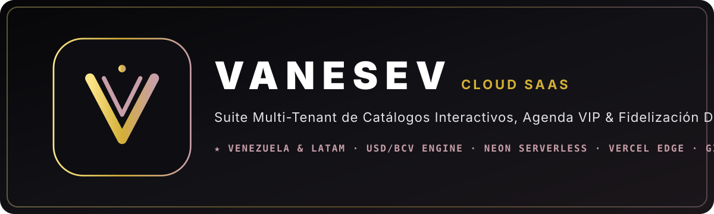

  

   

  
  
  
  

---

## 🦋 Sobre VANESEV Technologies (`vanesev.com`)

**VANESEV** es una plataforma **SaaS Multi-Tenant de próxima generación** diseñada específicamente para digitalizar y escalar **Salones de Belleza, Estudios de Uñas, Barberías VIP, Spas y Centros Estéticos en Venezuela y Latinoamérica**.

Nacida con una visión de excelencia, transformación y legado familiar (*Vane + Seven*), nuestra suite combina diseño de lujo editorial con ingeniería 100% Cloud-Native.

---

## 🏛️ Arquitectura de 4 Zonas (Ecosistema Multi-Tenant)

| Zona | Nombre del Módulo | Propósito Principal | Ruta / Acceso |
| :--- | :--- | :--- | :--- |
| **ZONA 1** | **VANESEV Comercial** | Landing page corporativa de alta conversión, planes SaaS y escaparates en vivo por rubro. | `vanesev.com` |
| **ZONA 2** | **VANESEV Central** | Panel Super-Admin exclusivo de dirección: alta instantánea de salones, editor de URLs/subdominios, buzón ejecutivo Agente-Director, reportes y ruta de lanzamiento. | `vanesev.com/central` |
| **ZONA 3** | **Admin Pro V2 del Salón** | ERP/CRM operativo para dueños de salones: Agenda inteligente, **Personal & Comisiones (`staff_members`)**, **Zonas/Estaciones (`studio_zones`)**, Catálogo USD/Bs BCV, Finanzas y Fidelización. | `[salon].vanesev.com/admin` |
| **ZONA 4** | **PWA del Salón + Mi Cuenta VIP** | Catálogo interactivo, reserva en 3 pasos y App privada del cliente final con **Mis Citas en vivo**, **Tarjeta Digital de Sellos** y **Guía Interactiva de Recompensas**. | `[salon].vanesev.com` / `vanesev.com/s/[salon]` |

---

## 🛡️ Gobernanza de Ingeniería & Flujo 100% Cloud

1. **Zero-Local-Build Policy:** Toda validación de tipos (`tsc --noEmit`), linting y compilación de producción (`vite build`) se ejecuta exclusivamente en máquinas virtuales de **GitHub Actions (`ubuntu-latest`, 7 GB RAM)** y en la red Edge de **Vercel**.
2. **Estrategia Estricta de Ramas (Branch Verification Protocol):**
   - `staging` / `preview`: Rama de verificación obligatoria conectada a entornos Preview de Vercel y ramas aisladas de Neon DB.
   - `main` (`production`): Rama protegida de producción. Ningún cambio llega a producción sin superar el pipeline de verificación en `staging`.
3. **Adaptación Nativa al Mercado Venezolano:**
   - Motor bimoneda en tiempo real (**USD $ + Bolívares BCV**).
   - Conciliación rápida para **Pago Móvil Interbancario**, **Binance Pay (USDT)**, **Zelle** y **Efectivo Divisas**.
   - Despacho y recordatorios automatizados vía **WhatsApp Concierge (`wa.me`)**.

---

## 🏆 Portafolio de Negocios Activos & Demos Oficiales

* 💅 **Andrea Labrador Nails** (`Flagship Studio` — San Cristóbal, Táchira)
* 🌸 **Capra Studio · By María Giovanna Capra** (`Multi-Department Beauty, Brows, Hair, Makeup & Academy`)
* 👟 **VORA Elite** (`Luxury Streetwear & Gala Catalog Architecture`)

---

  © 2026 <b>VANESEV Technologies</b> · Engineered with precision for Venezuela &amp; LatAm.

